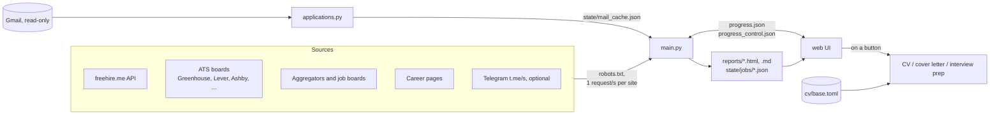
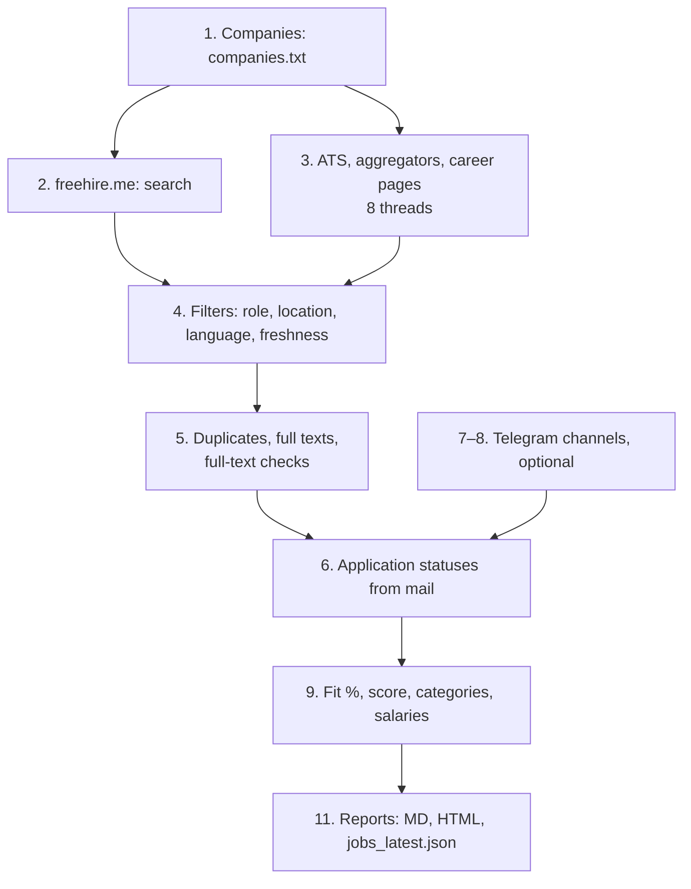
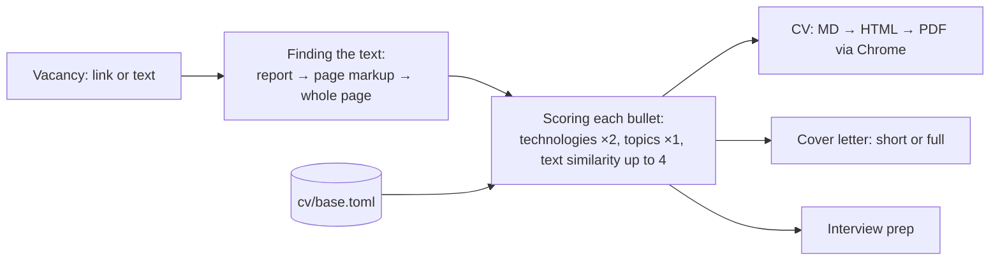

# How job-hunter works

[← README](../README.md)

An overview of the project: where vacancies come from, what happens to them before they reach the report, and
how CVs, cover letters, applications and the web UI work on top of the report.

This is the big picture and the reasons behind the decisions. Details, flags and settings are in the other
documents in `docs/`, linked at the end of each section. What the tool can do is described in the
[README](../README.md) and [web-ui.md](web-ui.md).

## Contents

- [The big picture](#the-big-picture)
- [Where things are](#where-things-are)
- [Collecting vacancies](#collecting-vacancies)
- [Score and Fit %](#score-and-fit-)
- [CV and cover letter for a vacancy](#cv-and-cover-letter-for-a-vacancy)
- [Applications from mail](#applications-from-mail)
- [Web UI and run control](#web-ui-and-run-control)
- [How we treat other people's sites](#how-we-treat-other-peoples-sites)
- [Where to look next](#where-to-look-next)

## The big picture

There are two scripts and a local web server. `applications.py` reads the mailbox, `main.py` collects vacancies.
Each script is started (by Task Scheduler / cron through `run_daily.bat`, in Docker, or by a button in the UI),
does its job and exits. There is no database, task queue or long-running background process: everything that
must survive between runs lives in files in `state/` and `reports/`.

The rest follows from that. The scripts and the server share no memory, so they talk through files: a run
writes its state to `state/progress.json` and the UI reads it; to skip a stage, the UI writes a request to
`state/progress_control.json` and the run checks it. Files are written whole through a temporary file, so a
half-written JSON can never be read.

**Why mail first, then vacancies.** The vacancy report marks where you have already applied, and those statuses
come from fresh letters. So `applications.py` always runs first, and the web UI runs them in the same order.

**Why no database.** A day brings thousands of vacancies, not millions. Plain JSON files are easier to open,
compare and fix by hand. To know which vacancies are new, one file is enough: `state/seen.json` — a link and the
date it was first seen.

More: [pipeline.md](pipeline.md) · [configuration.md](configuration.md) · [docker.md](docker.md)

## Where things are

| Where | What |
|---|---|
| `main.py` | Collecting vacancies: 11 stages from the company list to the reports |
| `applications.py` | Mail: new letters → application statuses → the applications page |
| `cvgen.py` | The CV generator from the command line (the generator itself is `jobhunter/cvgen.py`) |
| `jobhunter/` | The main code, one module per task (see below) |
| `web/` | Web UI: a FastAPI server (`app.py`), page templates, CSS and JS |
| `cv/base.toml` | **All facts about you**: CVs, cover letters and interview prep are built from it |
| `settings.toml`, `profile.toml` | Run settings and skills with weights; edits from the UI go to `profile_overrides.json` |
| `ats_mapping.json`, `companies.txt` | The company list and where their vacancies are — data, not code |
| `state/`, `reports/`, `cv_out/` | State between runs, reports, built CVs and letters (not in git) |
| `tests/` | Tests without network and personal files (see [testing.md](testing.md)) |

Modules in `jobhunter/` by purpose:

- **Basics:** `http` (requests to sites with limits), `models` (vacancy and company), `config`, `keys`
  (normalised URLs and company names), `progress` (run progress), `release_notes` (RELEASE_NOTES.md from the git history).
- **Vacancy sources:** `ats` (public ATS APIs and board discovery), `freehire`, `aggregators`, `sites` (job boards
  and career pages), `bigtech` (Workday, Oracle, Microsoft, Amazon), `telegram`.
- **Selection:** `filters` (title, location, employment), `verify` (full-text checks), `language`, `staffing`,
  `geo`, `levels`.
- **Scoring:** `relevance` (score), `cv_match` (Fit % and missing skills), `salary`, `tiers`, `industry`
  (company industry; does not change the score).
- **Results:** `report`, `html_report`, `cvgen`, `cover_letter`, `interview_prep`, `outreach`, `market_check`,
  `mail`, `applications_report`, `applied`, `manual_apps`, `vacancy_lookup`, `coverage` (why a source gave
  nothing).

A source only returns vacancies and knows nothing about filters and reports. To add one, write a function that
returns vacancies and add it to the source list (`SOURCES` in `aggregators.py` or `sites.py`).

More: [configuration.md](configuration.md) · [sources.md](sources.md#fixing-ats_mappingjson)

## Collecting vacancies

The biggest part of the project. The main principle: **do not trust the site's labels**. "Remote" on a card
means nothing until the full vacancy text confirms it.

**Fast, but without load on the sites.** Hundreds of sources are processed in 8 threads, but each site gets at
most one request per second: every site has its own queue. The whole collection takes minutes, not an hour, and
no site gets extra requests.

**The board list maintains itself.** `ats_mapping.json` records which ATS a company uses and under what name. The
name is guessed automatically; if the guess fails, there is a new attempt in 30 days. If a board is gone (404,
401/403/410, or an HTML page instead of data), it is searched again in the same run. Entries fixed by hand are
marked `"manual": true` and automation leaves them alone.

**Duplicates.** Two vacancies are one if their links match, or the company and the title. A vacancy found both on
freehire and on an ATS appears once, with the source `freehire + greenhouse`, and the link leads to the original.

**Freshness without a date.** Many sources do not give a publication date. Then the age counts from the day the
vacancy was first seen (`state/seen.json`), so old vacancies do not pass as new.

**Rejected vacancies stay visible.** Every rejected vacancy keeps a reason and a quote from the text. They go to
the "Rejected by filters" section and to `state/rejected_latest.tsv`. If a filter is wrong, it shows, and a
vacancy does not disappear silently.

More: [pipeline.md](pipeline.md) · [sources.md](sources.md) · [filters.md](filters.md)

## Score and Fit %

These are two different measures, do not mix them up.

- **Score** (`relevance`) — how well the vacancy suits you: skills from `profile.toml` with weights, Python /
  Backend / PostgreSQL in the title, product or not, location. The report is sorted by score.
- **Fit %** (`cv_match`) — how well your CV covers the vacancy's requirements. 85% of it is the share of key
  skills present in the CV, 15% — of nice-to-have ones. Each clear mismatch (experience, PhD, another primary
  language) takes 15 off.

Fit reads wording carefully. A skill under "nice to have" is not required. With "Python, Go or Java" one of them
is enough. A skill counts even if the CV does not name it literally but has something implying it
(`CV_ALIASES`: FastAPI implies asyncio and Pydantic). Words outside the dictionary count too: a capitalised term
that appears 3+ times or is in the vacancy title is a key skill.

More: [scoring.md](scoring.md)

## CV and cover letter for a vacancy

The main rule: **the generator writes nothing that is not in `cv/base.toml`**. It is not a request to a neural
network — there is none here. The generator only selects and orders ready-made bullets from the base.

**One scoring for everything.** CV, cover letter and interview prep pick bullets the same way (`cvgen.Vacancy`),
so for one vacancy they talk about the same things. Next to the result you can see why each bullet was picked:
the score, matching technologies and topics.

**No neural embeddings.** Text similarity is computed simply (TF-IDF): words are cut to a stem, and words present
all over the CV weigh less. A model like sentence-transformers would bring ~2 GB of dependencies for a few dozen
bullets.

**One page is checked, not guessed.** The short CV is rendered to PDF and its pages are counted. If there is more
than one, it shrinks step by step: skill groups first, then experience bullets, then the summary.

**Gaps are not hidden.** The generator shows which key skills of the vacancy your CV lacks, and the full letter
says so in a separate line.

More: [cv.md](cv.md) · [interview-prep.md](interview-prep.md) · [market-check.md](market-check.md)

## Applications from mail

Only the mailbox knows what happened after an application. Gmail access is read-only: letters are not sent,
marked as read or deleted.

**Letters are parsed by rules, without a neural network.** The company comes from the sender (an ATS), the
subject, the letter text or the mail domain. The letter type is chosen by priority: offer, rejection, stage,
invitation in the text, application confirmation. Quoted old letters are cut off before parsing, and conditional
phrases ("If you are not selected…") count neither as a rejection nor as an invitation.

**Silence counts too.** No answer for longer than `timeout_days` (14 days) — the application counts as rejected.
A new application to the same company after a rejection is "waiting" again.

**Not only mail.** Telegram, LinkedIn and calls go to `applications_manual.toml` (with the form in the UI or by
hand). These events are merged with the letters of the same company into one history.

**Works without mail too.** If the token has expired or Gmail is unavailable, the applications page is built from
saved letters and the reports show a red warning. Old data is better than none.

More: [applications.md](applications.md)

## Web UI and run control

The server (`python -m web`, port 8765) is available **only from this computer**. The reports contain mail,
applications and contacts, and there is no login, so the server is never exposed.

**A run is a separate process.** The server starts `applications.py` and `main.py` one after another as separate
processes. Two runs never go at once. The UI sees a run even if it was started from a terminal: it checks
`progress.json` and whether the process writing it is alive.

**Progress in real time.** The page receives `progress.json` updates as they happen (SSE,
`GET /api/progress/stream`). The stages, the event feed and the time-left estimate (from past run durations in
`progress_history.json`) are drawn from it.

**Two ways to stop.**

- *Skip a stage.* The UI leaves a request in `progress_control.json`, the stage sees it between steps and ends.
  Requests already sent are aborted too (`http.cancel`). Such an abort is deliberately not an error (`Cancelled`
  inherits from `BaseException`, not `Exception`), so a source that did not finish is not marked broken.
- *Stop entirely.* The queue is cleared and the run process ends with all its children (`taskkill /T` on
  Windows). The report of the previous run stays.

**Heavy pages are cached.** "CV vs market" and "Skills" are computed in the background when the server starts and
after each run, and stored in `state/web_cache.json` (keyed by the modification time of vacancies, CVs and
letters), so they open instantly.

Remember: restarting the server during a run interrupts the run. Restart it when there is no running-run badge at
the bottom of the left panel.

**Pages are built by the server** (Jinja2): the same data goes to the template and to the API.

More: [web-ui.md](web-ui.md#how-pages-are-built) · [pipeline.md](pipeline.md#how-it-works)

## How we treat other people's sites

These rules cannot be turned off by a setting: all requests to sites go through one module, `http`, and there is
no other way.

- **robots.txt** is read before the first request to a site. It is parsed by our own code, because Python's
  standard module does not understand `*` and `$`. Disallowed pages are not requested. If robots.txt cannot be
  opened or returns an error, the whole site is skipped.
- **At most one request per second per site** (or less often, if `Crawl-delay` asks). On 429 or 5xx the request
  is repeated after a pause. A host that times out or drops the connection on `Http.UNREACHABLE_AFTER` (2)
  requests in a row is skipped until the end of the run.
- **Bot protection is not bypassed.** Sites that load vacancies with scripts or close them in robots.txt are not
  connected.
- **Nothing is sent.** No applications, no messages. LinkedIn is not read.

More: [sources.md](sources.md#rules-for-every-source)

## Where to look next

| If you need to deal with… | Read |
|---|---|
| A new source or ATS | [sources.md](sources.md), `jobhunter/ats.py`, `jobhunter/sites.py` |
| A wrongly found company board | [sources.md](sources.md#fixing-ats_mappingjson) |
| Filters and full-text checks | [filters.md](filters.md), `jobhunter/verify.py` |
| Company industries, the Companies page | [industry.md](industry.md), `jobhunter/industry.py` |
| Vacancy order, score, Fit % | [scoring.md](scoring.md), `jobhunter/relevance.py`, `jobhunter/cv_match.py` |
| CV, cover letter, interview prep | [cv.md](cv.md), [interview-prep.md](interview-prep.md), `cv/base.example.toml` |
| Mail and application statuses | [applications.md](applications.md), `jobhunter/mail.py` |
| Run stages and stopping | [pipeline.md](pipeline.md), `jobhunter/progress.py` |
| A slow run or page | [pipeline.md](pipeline.md#run-speed), [web-ui.md](web-ui.md#how-pages-are-built) |
| UI pages and the API | [web-ui.md](web-ui.md), `http://127.0.0.1:8765/docs` |
| Settings and personal files | [configuration.md](configuration.md) |
| Tests, CI and the API check | [testing.md](testing.md), `tests/test_api_schema.py` |
| Running in Docker | [docker.md](docker.md) |
